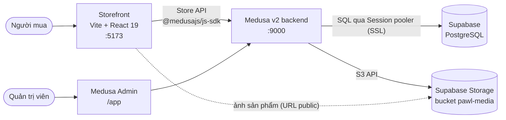

<div align="center">

# 🐾 Pawl

**Cửa hàng online cho chó mèo - thức ăn, cát vệ sinh, snack, dinh dưỡng bổ sung và phụ kiện.**

Đồ án môn Electronic Commerce (CO3027) · Website B2C xây dựng trên Medusa v2 và Supabase


</div>

> [!NOTE]
> Đây là **dự án học tập, không kinh doanh thật**. Thông tin doanh nghiệp trên website là dữ liệu demo và thanh toán online là **giả lập**, không kết nối ngân hàng hay cổng thanh toán nào.

## Mục lục

- [Giới thiệu](#giới-thiệu)
- [Tính năng](#tính-năng)
- [Kiến trúc](#kiến-trúc)
- [Công nghệ](#công-nghệ)
- [Cấu trúc thư mục](#cấu-trúc-thư-mục)
- [Bắt đầu nhanh](#bắt-đầu-nhanh)
- [Lệnh thường dùng](#lệnh-thường-dùng)
- [Tài khoản demo](#tài-khoản-demo)
- [Thanh toán](#thanh-toán)
- [Bảo mật](#bảo-mật)
- [Kiểm thử](#kiểm-thử)
- [Tài liệu](#tài-liệu)
- [Lộ trình](#lộ-trình)

## Giới thiệu

Pawl bán đồ cho thú cưng (chó và mèo) ở TP.HCM và Hà Nội, những người quen mua sắm và thanh toán online. **Phase 1** là một cửa hàng hoàn chỉnh, đáp ứng các yêu cầu bắt buộc của đồ án: quản lý sản phẩm, giỏ hàng, thanh toán, quản lý đơn hàng, tuỳ chọn giao hàng và bảo mật. **Phase 2** bổ sung hồ sơ thú cưng, gợi ý sản phẩm và đặt hàng định kỳ.

Giao diện storefront bằng tiếng Anh, giá tính bằng VND (đã gồm VAT), địa chỉ theo 34 tỉnh/thành của Việt Nam.

## Tính năng

### Khách hàng (storefront)

| Nhóm | Chức năng |
|---|---|
| Duyệt sản phẩm | Trang chủ, danh mục Mèo/Chó, tìm kiếm, lọc theo loài, độ tuổi, nhu cầu sức khoẻ, thành phần "không chứa", dạng sản phẩm và khoảng giá; sắp xếp, phân trang; bộ lọc nằm trên URL để chia sẻ được |
| Chi tiết sản phẩm | Gallery, chọn biến thể (khối lượng/quy cách), giá và tồn kho theo biến thể, thành phần, hướng dẫn cho ăn, sản phẩm liên quan |
| Giỏ hàng | Mini-cart và trang giỏ, đổi số lượng, xoá, mã giảm giá, giỏ được giữ lại giữa các lần truy cập |
| Checkout | Một trang, 5 bước: liên hệ → địa chỉ → giao hàng → thanh toán → xác nhận; validate từng bước |
| Thanh toán | Thanh toán khi nhận hàng (COD) và chuyển khoản qua mã QR (giả lập) |
| Tài khoản | Đăng ký, đăng nhập, quên/đặt lại mật khẩu, thông tin cá nhân, sổ địa chỉ, lịch sử và chi tiết đơn, "Mua lại" |
| Nội dung | Chính sách (điều khoản, bảo mật, vận chuyển, đổi trả, thanh toán), giới thiệu, liên hệ, trang 404 |
| Trợ lý AI (Phase 2) | Chatbot "Pawl Assistant" dùng Gemini: tìm và so sánh sản phẩm theo nhu cầu của thú cưng, tính khẩu phần ăn, tra cứu đơn của chính khách đã đăng nhập, trả lời về giao hàng, thanh toán, đổi trả. Chỉ đọc dữ liệu qua Medusa, không truy cập database trực tiếp ([docs/chatbot.md](docs/chatbot.md)) |
| Trải nghiệm | Responsive từ 375px, accessibility cơ bản (label, focus, tương phản AA), SEO theo từng trang |

### Quản trị (Medusa Admin)

Sản phẩm, biến thể, giá, ảnh (lưu trên Supabase Storage), tồn kho, danh mục, collection, đơn hàng, khách hàng và khuyến mãi — dùng Medusa Admin có sẵn tại `/app`.

## Kiến trúc



- Mọi nghiệp vụ (sản phẩm, giỏ, đơn, đăng nhập) đi qua API của Medusa. Storefront **không** gọi Supabase trực tiếp.
- Supabase chỉ đóng vai trò database và kho ảnh; bảng được tạo bằng migration của Medusa, Data API của Supabase được tắt.
- Không cần Docker hay Redis: Medusa dùng event bus và bộ nhớ đệm in-memory.

## Công nghệ

| Lớp | Công nghệ |
|---|---|
| Backend | [Medusa v2](https://docs.medusajs.com) (Node.js, TypeScript), Caching Module in-memory |
| Database | Supabase PostgreSQL qua Session pooler (cổng 5432, SSL) |
| Lưu trữ ảnh | Supabase Storage qua provider `@medusajs/medusa/file-s3` |
| Storefront | Vite, React 19, TypeScript strict, React Router v7 |
| Dữ liệu & form | TanStack Query v5, React Hook Form, Zod |
| Giao diện | Tailwind CSS v4, `react-markdown` cho trang chính sách |
| Thanh toán | COD (`pp_system_default`) và QR chuyển khoản giả lập (`pp_qr_qr`, provider tự viết) |
| Giao hàng | 2 phương thức giá cố định (fulfillment provider manual) |
| Kiểm thử & chất lượng | Jest (backend), oxlint (storefront), `tsc` |

## Cấu trúc thư mục

```
pawl/
├── apps/
│   ├── backend/                 # Medusa v2: API, Admin, payment provider QR, seed scripts
│   │   ├── medusa-config.ts
│   │   └── src/
│   │       ├── api/             # route tự viết (POST /store/qr-payments/confirm) + middlewares
│   │       ├── modules/         # qr-payment: Payment Module Provider
│   │       ├── subscribers/     # email xác nhận đơn, đặt lại mật khẩu (in ra console)
│   │       └── scripts/         # check-db, seed, seed-catalog, clear-catalog-and-orders, reset-demo-data
│   ├── storefront/              # Vite + React
│   │   └── src/
│   │       ├── app/             # router, providers, guards
│   │       ├── pages/           # mỗi file một route
│   │       ├── features/        # catalog, cart, checkout, auth, account, orders… (API + hooks)
│   │       ├── components/      # ui/ và layout/
│   │       └── content/         # chính sách viết bằng Markdown
│   └── implementation.md        # chi tiết triển khai, dữ liệu mẫu, thanh toán giả lập
├── docs/                        # hướng dẫn Supabase, cài đặt chi tiết, API
└── materials/                   # thiết kế landing page, bảng màu, ảnh QR
```

Hai app độc lập, mỗi app có `package.json` và lockfile riêng (npm, không dùng workspace).

## Bắt đầu nhanh

### Yêu cầu

- Node.js **20.19+** hoặc **22.12+** (khuyến nghị 22 LTS), npm 10+
- Tài khoản [Supabase](https://supabase.com) (gói Free là đủ)

### 1. Chuẩn bị Supabase

Tạo project ở **region Singapore**, lấy connection string **Session pooler**, tắt Data API, tạo bucket public `pawl-media` và S3 access key. Làm theo từng bước ở [docs/supabase-setup.md](docs/supabase-setup.md).

### 2. Backend

```bash
cd apps/backend
npm install
cp .env.example .env                           # điền DATABASE_URL, S3_*, JWT_SECRET, COOKIE_SECRET
node ./src/scripts/check-db.mjs                # kiểm tra kết nối tới Supabase
npx medusa db:migrate                          # tạo bảng (lần đầu mất vài phút)
npx medusa exec ./src/scripts/seed.ts          # store, region VN, kho, vận chuyển, publishable key
npx medusa exec ./src/scripts/seed-catalog.ts  # danh mục, 44 sản phẩm, upload ảnh từ materials/Items
npx medusa user -e admin@pawl.local -p <mat-khau>
npm run dev                                    # http://localhost:9000/app
```

### 3. Storefront

```bash
cd apps/storefront
npm install
cp .env.example .env                           # điền VITE_MEDUSA_PUBLISHABLE_KEY (seed.ts in ra key này)
npm run dev                                    # http://localhost:5173
```

Hướng dẫn đầy đủ, ý nghĩa từng biến môi trường và bảng xử lý sự cố: [docs/setup.md](docs/setup.md).

> [!IMPORTANT]
> Project Supabase gói Free **tự tạm dừng sau 7 ngày không hoạt động**. Trước buổi demo hoặc chấm bài, vào dashboard kiểm tra project đang chạy (bấm **Restore** nếu bị dừng).

## Lệnh thường dùng

| Thư mục | Lệnh | Tác dụng |
|---|---|---|
| `apps/backend` | `npm run dev` | Chạy API và Admin ở chế độ phát triển |
| `apps/backend` | `npm run build` | Build production |
| `apps/backend` | `npm run test:unit` | Unit test provider QR và route xác nhận thanh toán |
| `apps/backend` | `npx medusa db:migrate` | Chạy migration mới |
| `apps/storefront` | `npm run dev` | Chạy storefront với hot reload |
| `apps/storefront` | `npm run build` | Typecheck và build production |
| `apps/storefront` | `npm run lint` | Kiểm tra code bằng oxlint |

## Tài khoản demo

| Vai trò | Đăng nhập ở | Tài khoản |
|---|---|---|
| Quản trị viên | https://pawl-be-dcamczb6h9bfcxbw.malaysiawest-01.azurewebsites.net/app | `admin@pawl.local`, mật khẩu tạo bằng `npx medusa user` (nhóm gửi riêng, không lưu trong repo) |
| Khách hàng | https://pawl-two.vercel.app//register | Tự đăng ký; link đặt lại mật khẩu in ra console của backend |
| Khách vãng lai | https://pawl-two.vercel.app/ | Không cần tài khoản, checkout bằng email và số điện thoại |

Mã giảm giá demo: **`PAWL10`** (giảm 10% toàn đơn).

## Thanh toán

| Phương thức | Provider | Trạng thái đơn |
|---|---|---|
| Thanh toán khi nhận hàng (COD) | `pp_system_default` | Authorized, thu tiền khi giao |
| Chuyển khoản qua mã QR | `pp_qr_qr` | Captured ("Paid" trong Admin) |

Luồng QR **là giả lập**: trang `/checkout/pay` hiển thị ảnh QR tĩnh, số tiền, nội dung chuyển khoản và đồng hồ 15 phút; khi khách bấm xác nhận, route `POST /store/qr-payments/confirm` đóng vai ngân hàng báo đã nhận tiền rồi tạo đơn. Khi demo **không cần và không nên chuyển tiền thật**. Chi tiết và ràng buộc phía server: [apps/implementation.md](apps/implementation.md#thanh-toán).

## Bảo mật

- Secret (mật khẩu database, S3 key, `JWT_SECRET`, `COOKIE_SECRET`) chỉ nằm trong `apps/backend/.env`; repo chỉ chứa `.env.example`.
- Storefront chỉ có URL backend và publishable key của Medusa; không dùng bất kỳ key Supabase nào.
- Kết nối database luôn qua SSL; Data API của Supabase được tắt.
- CORS chỉ mở cho đúng origin; backend từ chối khởi động ở production nếu secret còn là giá trị mẫu.
- Body của route tự viết được validate bằng Zod; thanh toán QR kiểm tra phiên, giỏ hàng, nội dung chuyển khoản, hạn và chống tạo đơn trùng.
- Trang tài khoản, giỏ hàng và checkout được đánh dấu `noindex`.
- Chatbot: key Gemini chỉ ở backend; Gemini chỉ gọi được các hàm chỉ-đọc do backend định nghĩa, mã khách hàng lấy từ session chứ không từ câu hỏi; giới hạn số tin nhắn; không ghi log nội dung chat.

## Kiểm thử

```bash
cd apps/backend && npm run test:unit       # 31 test: thanh toán QR (phiên, hạn, xác nhận, idempotency) và chatbot (tìm kiếm, khẩu phần, vòng gọi tool, validate, rate limit)
cd apps/storefront && npm run lint && npm run build
```

Kịch bản kiểm tra thủ công (COD, QR, mã giảm giá, tài khoản): [docs/setup.md, mục 5](docs/setup.md#5-kiểm-tra-nhanh-sau-khi-cài).

## Tài liệu

| Tài liệu | Nội dung |
|---|---|
| [docs/supabase-setup.md](docs/supabase-setup.md) | Tạo và cấu hình project Supabase (`pawl-dev`, `pawl-demo`) |
| [docs/setup.md](docs/setup.md) | Cài đặt chi tiết, chuyển sang database demo, hiệu năng, xử lý sự cố |
| [docs/api.md](docs/api.md) | Route tự viết, payment provider QR, luồng checkout và tài khoản qua Store API |
| [docs/chatbot.md](docs/chatbot.md) | Chatbot Gemini: kiến trúc, các tool, bảo mật, cách lấy API key và chạy thử |
| [docs/deploy.md](docs/deploy.md) | Deploy lên Internet: storefront trên Vercel (proxy API cùng domain), backend trên Azure App Service (deploy bằng GitHub Actions), các bước kiểm tra và sự cố |
| [apps/implementation.md](apps/implementation.md) | Chi tiết triển khai: dữ liệu mẫu, thanh toán giả lập, hiệu năng, các lưu ý khi làm việc nhóm |

## Lộ trình

- [x] **Phase 1** — cửa hàng hoàn chỉnh: catalog, giỏ hàng, checkout, COD + QR giả lập, tài khoản, chính sách, SEO
- [ ] **Phase 2** — [x] chatbot Gemini · [ ] hồ sơ thú cưng · [ ] gợi ý sản phẩm theo hồ sơ · [ ] đặt hàng định kỳ 2/4/6 tuần · [ ] tích hợp GHN

---

<div align="center">
<sub>Pawl · Đồ án Electronic Commerce (CO3027) · Dự án học tập, không kinh doanh thật</sub>
</div>
